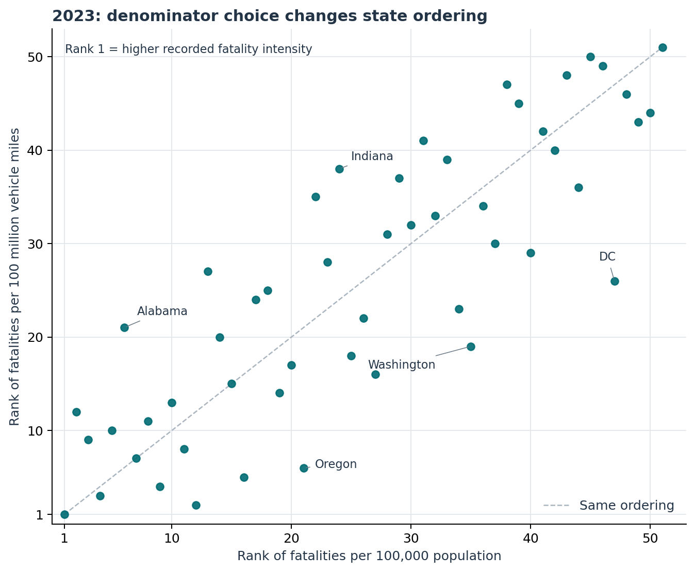

# Denominators and state fatality comparisons

In the fixed 2023 NHTSA report, population versus vehicle-mile denominators reverse **222 of 1,275 state-pair orderings**. Their top-five sets share two states and their top-ten sets share six. The largest rank movement is 21 places. These are differences between descriptive measures; they do not establish individual road-user risk or a causal state safety ranking.

Report the count, denominator, unit, geographic event basis and vintage together. Preserve exact subgroup counts when available. The selected 2019/2021 person-type tables give whole percentages; 2023 adds exact counts. Its pedalcyclist coarsening sensitivity guarantees seven of the 126 reversals found with exact counts and leaves 119 of those reversals unresolved. All exact and conditional comparisons remain available.

Read the [eight-page manuscript](paper/manuscript.pdf), [fixed protocol](PROTOCOL.md), [prospective source-schema update](SOURCE_SCHEMA_UPDATE.md), [sources](SOURCES.md) and [publication boundary](DATA_RIGHTS.md). This independent AI-assisted study is not peer reviewed or accepted for formal publication. Formal-publication projects, including Azure optimization, remain private.



## Evidence and reproduction

The panel includes all 50 states and DC in three separate report-year snapshots. Before 2023 analytic ranking outcomes, nineteen canonical dependencies were publicly frozen. All source cells, coverage, totals and printed-rate consistency checks were allowed before freeze; the source data were not blinded. No model, threshold search or optimized shortlist budget is claimed.

Thirteen boundary tests; 1,872 numeric source checks; 3,498 selected PDF cells/locators independently compared by two engines; six rendered source-table pages; 127,530 development and 63,765 evaluation values independently reconstructed, plus 72,126 exact-subgroup comparator/containment checks; 653,886 exact fields/documents and 5,517 floating values rebuilt offline; 138 plotted values; all eight manuscript pages visually checked. Finite checks do not certify universal correctness or accessibility conformance.

With Python 3.10:

```sh
python -m pip install -r requirements.txt
python -m unittest discover -s tests -v
python src/check_reproduction.py
python src/verify_figures.py
python src/verify_paper.py
python src/verify_public_package.py
```

Public replay uses selected factual cells and needs no live network or PDFs. Complete official responses and decoded reports stay outside Git. The retained source certificate documents the earlier full second-engine comparison; optional source verification uses `requirements-source.txt` and those excluded originals. All registered-vehicle fields and source-report copies are excluded.

## Interpretation limits

Population is not traveler exposure, and fatalities in a state may involve nonresidents. Motor-vehicle miles and licensed-driver counts are not pedestrian/cyclist person-distance or motorcycle-specific mileage. The three ARF report snapshots are not latest harmonized FARS data; vehicle and motorized-bicycle classification changes limit cross-year subgroup interpretation. Closed display-precision/count ranges are conditional scenarios, not sampling intervals or bounds on underlying exposure error. Unresolved comparisons are not proof of reversals. No clinical, legal-compliance, personal-safety, causal-policy, deployment or realized-benefit claim is made.
